# Walkie-Claudie

> Anthropic 공식 프로젝트가 아닙니다. 개인 프로젝트입니다. · Not an official Anthropic project.

[한국어](#한국어) · [English](#english)

---

## 한국어

<p align="center">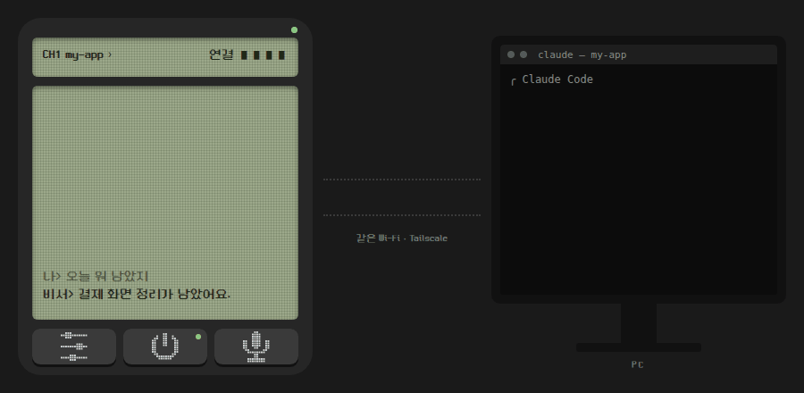</p>

### 개요
안드로이드 기기를 사용해 PC상의 Claude Code 세션과 무전기처럼 통신하기 위한 애플리케이션임.

### 주요 기능
- 무전 송수신(음성): PC상 Claude Code 세션 ↔ 사용자
- 떠 있는 버튼, 음량 버튼(PTT 느낌), 블루투스 이어폰 버튼을 취향에 따라 무전기 버튼으로 활용
- 독백 모드: 사용자가 길게 말할 경우 중간에 오래 쉬어도 끊지 않고 최대 10분까지 받아 한 번에 전송
- 다중 채널: 각 세션 = 채널 개념
  - 타 채널의 답도 청취 가능(무전기의 채널 탐색 개념)
- 남은 일 목록: Claude가 관리하는 남은 일(답을 기다리는 질문, 승인, 진행 중인 작업)을 화면에 표시

### 제작 배경
개발자의 본업은 택배 기사임. 배송하는 짬짬이 휴대폰으로 Claude Code의 원격 제어(Remote Control) 기능을 활용해 바이브 코딩을 해 봤으나

1. 배송하면서 키보드로 미주알고주알 입력하는 게 쉽지 않은 점
2. 배송 앱과 Claude 앱 사이를 왔다 갔다 하는 것도 쉽지 않은 점
3. 배송하면서 Claude의 답변을 세세하게 읽는 것도 쉽지 않은 점
4. 배송과 바이브 코딩을 함께 할 때 눈과 손은 정신없는데, 귀와 입은 유휴 상태로 남아 있다는 점

이상 4가지 주요 사항을 종합한 결과 '배송하면서 입과 귀로 바이브 코딩을 해 보자'고 기획하였고, 퇴근 후 소주 한잔하면서 Claude Code에게 내 계획을 넌지시 제시함. 의외로 흔쾌히 가능하다고 해서 여기까지 옴.

### 원리
<p align="center">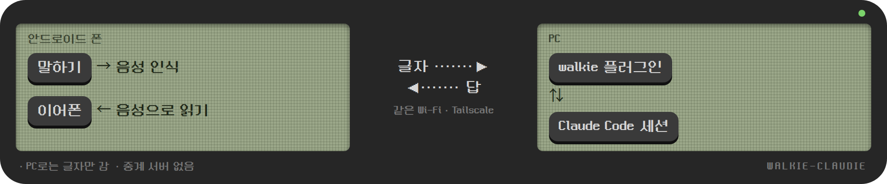</p>

- 말하기: 폰에서 음성 인식 → 글자로 PC의 walkie 플러그인에 전송 → 플러그인이 Claude Code 세션에 전달
- 답: Claude가 플러그인의 답장 도구로 답을 남김 → 폰이 가져와 음성으로 읽음
- 중계 서버 없이 폰이 PC로 직접 연결

### 설치 및 실행

#### 사양
- 폰: 안드로이드 10 이상(독백 모드는 13 이상)
- PC: 리눅스에서만 확인. macOS·윈도는 미검증
- 연결: 폰 → PC 포트 7700~7709 직접 연결(HTTP, 사설망 주소만)
- 앱 언어: 한국어, 영어

#### 준비물
- Claude Code(claude.ai 구독 로그인), [Bun](https://bun.sh)
- 폰과 PC가 서로 닿는 네트워크: 같은 Wi-Fi, 밖에서는 [Tailscale](https://tailscale.com) 같은 VPN

#### 설치 방법
> Claude Code에게 이 저장소 주소를 주고 "깔아줘"라고 해도 됨. 2단계 세션도 tmux 등으로 띄워 달라고 하면 됨(경고 창 확인은 직접). 3~5단계(폰)는 직접 해야 함

1. 터미널에서 PC에 플러그인 설치
   ```sh
   claude plugin marketplace add ahn4jang27/walkie-claudie
   claude plugin install walkie@walkie-claudie
   ```
2. 터미널에서 무전기로 대화할 새 Claude Code 세션을 `WALKIE_ENABLE=1`로 실행
   ```sh
   WALKIE_ENABLE=1 claude --dangerously-load-development-channels plugin:walkie@walkie-claudie
   ```
   윈도 PowerShell:
   ```powershell
   $env:WALKIE_ENABLE=1; claude --dangerously-load-development-channels plugin:walkie@walkie-claudie
   ```
   - 채널 기능이 아직 연구 미리보기라 개발용 플래그가 필요함. 시작할 때마다 경고 창 → Enter
   - `WALKIE_ENABLE=1`이 없는 세션에서는 플러그인이 포트·도구를 열지 않음
   - 기존 세션의 대화를 이어 쓰려면: 그 세션을 종료한 뒤 위 명령에 `--continue`(마지막 대화) 또는 `--resume`(골라서)을 붙여 다시 실행
3. 폰에 앱 APK 설치([Releases](../../releases) 또는 아래 '직접 빌드 / 개발')
   - Play 스토어 밖에서 받은 앱이라 Google Play 프로텍트가 설치를 막을 수 있음. 막히면:
     1. 경고 창에서 '자세히' → '그래도 설치'
     2. 그래도 안 되면: Play 스토어 › 프로필 › Play 프로텍트 › 설정(톱니) › 'Play 프로텍트로 앱 검사' 끄기 → APK 설치 → 같은 곳에서 다시 켜기
4. 2단계에서 띄운 세션 안에서 `/walkie:pair` 입력 → 나온 QR을 앱 **[설정] › 키 › QR**로 찍기
   - QR이 깨져 보이면: 터미널에서 `bun <플러그인 경로>/pair.ts`
   - QR을 찍을 수 없으면(같은 폰 화면 등): `pair.ts --text`의 연결 문구 복사 → 앱 **[설정] › PC 주소 › 붙여넣기**
5. 앱 첫 화면 **[켜기]** → 마이크·알림·'다른 앱 위에 표시' 권한 허용

설정 값(환경변수):

| 환경변수 | 기본값 | 뜻 |
|---|---|---|
| `WALKIE_ENABLE` | (없음) | `1`인 세션만 무전기 켜짐 |
| `WALKIE_PORT` | `7700` | 첫 채널 포트(다음 세션 +1, 최대 10개) |
| `WALKIE_NAME` | 세션 폴더 이름 | 채널 이름 |
| `WALKIE_STATE_DIR` | `~/.claude/channels/walkie` | 키·답 보관 위치 |

##### 직접 빌드 / 개발
- 앱: `cd android && ./gradlew assembleDebug`(JDK 17 이상, Android SDK) → `android/app/build/outputs/apk/debug/app-debug.apk`
- 신호음 다시 만들기: `python3 tools/sounds.py android/app/src/main/res/raw`
- 플러그인 테스트: `cd plugin && bun install && bun test`
- 기획 문서: [docs/PRD.md](docs/PRD.md)

### 화면 구성
<p align="center">
  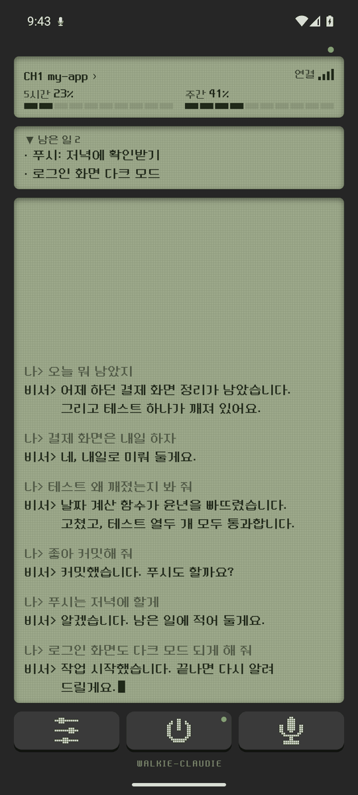
  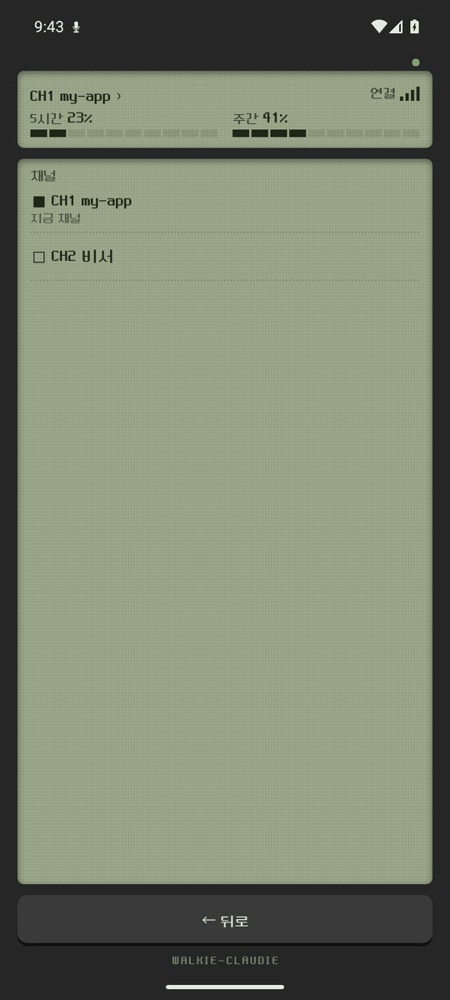
  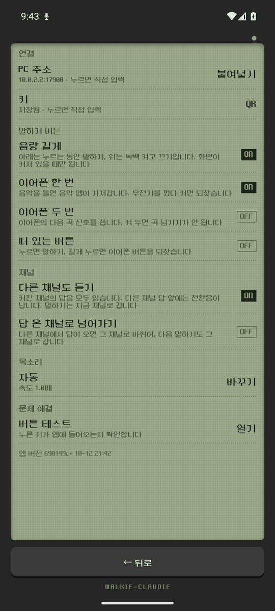
  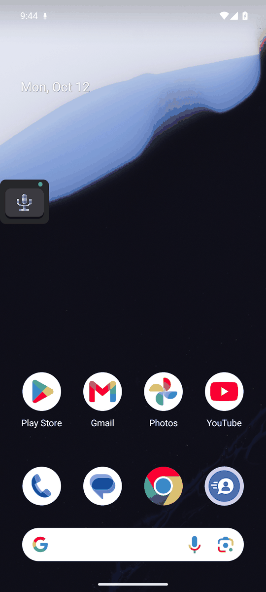
</p>

- 첫 화면: 위 채널·연결·사용량 / 가운데 남은 일 / 아래 대화 기록 / 버튼 [설정] [켜기/끄기] [말하기]
  - [켜기/끄기] 버튼 불: 켜짐 초록 / 꺼짐 어둡게. 꺼져 있으면 대화가 흐려지고 '꺼짐' 표시
- 채널 목록: 위 액정(`CH1 이름 ›`)을 누르면 열림
- 설정: PC 주소·키, 말하기 버튼별 켜고 끄기, 채널, 목소리, 버튼 테스트
- 떠 있는 버튼: 다른 앱 위에 뜨는 작은 무전기. 앱 화면에선 숨겨짐
  - 불: 연결 초록 / 송신 중 빨강 / 끊김 빨강 깜빡

### 사용 방법

#### 기본 흐름
1. 켜기: 첫 화면 [켜기] → 진동 1번 + 올라가는 전원음
2. 말하기: 아래 3가지 중 편한 버튼으로([설정]에서 각각 켜고 끔)
   - 떠 있는 버튼: 마이크 누르기 → '삐삐삑' 소리 후 말하기. 잠깐 멈춰도 안 끊김(최대 2분)
   - 음량 ▼ 길게: 누르는 동안 말하기. 짧게 누르면 평소 음량 조절. 화면이 켜져 있을 때만 됨, 접근성에서 Walkie-Claudie를 켜야 함
   - 블루투스 이어폰 버튼: 한 번(또는 두 번) 눌러 시작. 화면이 꺼져 있어도 됨
3. 보내기: 떠 있는 버튼·이어폰 버튼은 다시 누르기, 음량 ▼는 손 떼기 → PC가 받으면 확인음
4. 답 듣기: 호출음 → 음성으로 읽어 줌
5. 끄기: [끄기] → 진동 2번 + 내려가는 전원음

#### 부가 기능
- 독백 모드(길게 말할 때): 음량 ▲ 길게 → 올라가는 세 음 → 손 떼고 말하기 → 다시 ▲ 길게 누르면 전송. 오래 쉬어도 안 끊김(최대 10분). 화면이 켜져 있을 때만 시작 가능(시작하면 화면이 계속 켜져 있음)
- 채널(세션 여러 개): `WALKIE_ENABLE=1` 세션마다 빈 포트(7700, 7701, …)를 잡아 CH1, CH2, …로 표시
  - 위 액정을 누르면 채널 목록 → 고르면 전환 + 채널 이름 읽어 줌
  - 이름은 세션 폴더 이름, `WALKIE_NAME=비서`로 변경 가능
- 스캔(기본 켜짐): 켜진 채널을 모두 들음. 다른 채널 답은 '삑삑' 전환음 후 읽고 그 채널 기록에 남김. 내가 하는 말은 지금 채널로 감
  - [설정] › 채널에서 끄기 가능, '답 온 채널로 넘어가기'를 켜면 답 온 채널로 전환
- 목소리 바꾸기: [목소리] 화면에서 엔진·목소리·속도 선택
- 통화 중(인터넷 전화 포함): 이어폰 버튼 = 받기·끊기, 음량 버튼 = 통화 음량. 그사이 온 답은 통화 끝난 뒤 읽음
- 연결이 끊겼을 때: 보낸 말은 연결될 때까지 계속 재전송

### 기타 사항

#### 보안
- 이 앱으로 한 말에 따라 PC의 Claude가 명령을 실행할 수 있음 → 키 관리 주의
- 키: 첫 실행 때 자동 생성(`~/.claude/channels/walkie/key`), 키가 틀린 요청은 거절
- 사설망(192.168.x, 10.x, 172.16–31.x, Tailscale 100.64–127.x) 주소에서 온 연결만 받음
- 통신은 암호화되지 않음 → 카페 Wi-Fi 같은 공용 망에서는 내용이 보일 수 있음. Tailscale을 쓰면 암호화됨
- 키가 샜을 때: 키 파일 삭제 → 세션 다시 시작 → 다시 페어링

#### 문제 해결
- 앱이 계속 '끊김': 폰에서 PC 주소가 닿는지(같은 Wi-Fi 또는 Tailscale), PC 방화벽이 포트 7700~7709를 막지 않는지, 세션을 `WALKIE_ENABLE=1`로 띄웠는지 확인
- 'HTTP 401': 키가 다름 → `/walkie:pair`로 다시 연결
- 이어폰 버튼이 작동하지 않음: 음악·팟캐스트 앱이 버튼을 가져간 상태 → 떠 있는 버튼 길게 누르기
- 앱 설치가 막힘: Play 프로텍트 차단 → 설치 방법 3단계 참고
- 접근성 스위치가 회색: 앱 정보 › ⋮ › '제한된 설정 허용' 먼저
- 사용량이 안 보임: 사용량 조회가 비공식 기능이라 Claude Code 업데이트로 막힐 수 있음 → `settings.json`에 `"statusLine": {"type": "command", "command": "bun <플러그인 경로>/statusline.ts"}` 추가
- 버튼이 어떤 키로 잡히는지 궁금하면: [설정] › 버튼 테스트

---

## English

<p align="center">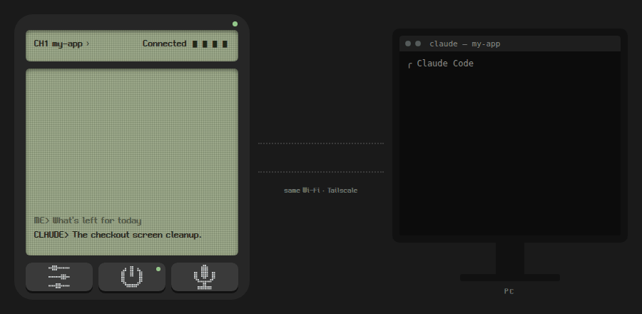</p>

### Overview
An Android app for talking to a Claude Code session on your PC like a walkie-talkie.

### Features
- Two-way voice radio: you ↔ a Claude Code session on your PC
- Use the floating button, the volume keys (push-to-talk style) or the Bluetooth earphone button as the radio key, whichever you like
- Monologue mode: for talking at length, it keeps listening through long pauses for up to 10 minutes and sends it all at once
- Multiple channels: each session is a channel
  - You can also hear replies on other channels (like a radio's channel scan)
- Open items: shows what Claude is keeping track of (questions waiting for your answer, approvals, tasks in progress)

### Background
My day job is parcel delivery. I tried vibe coding on my phone between drops, using Claude Code's Remote Control, but:

1. Typing out every little detail on a keyboard while delivering isn't easy.
2. Switching back and forth between the delivery app and the Claude app isn't easy either.
3. Reading Claude's replies closely while delivering isn't easy either.
4. When you deliver and vibe code at once, your eyes and hands are swamped, while your ears and mouth sit idle.

Putting those four together, the plan became: vibe code with my mouth and ears while delivering. After work, over a glass of soju, I casually pitched the plan to Claude Code. Surprisingly, it said "sure, that's doable", and here we are.

### How it works
<p align="center">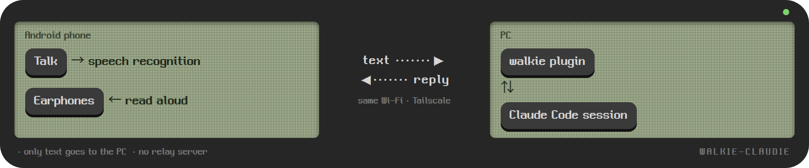</p>

- Talking: speech recognition on the phone → text sent to the walkie plugin on the PC → the plugin passes it to the Claude Code session
- Replies: Claude leaves its answer through the plugin's reply tool → the phone picks it up and reads it aloud
- No relay server: the phone connects straight to the PC

### Install and run

#### Specs
- Phone: Android 10+ (monologue mode: 13+)
- PC: tested on Linux only. macOS and Windows untested
- Connection: phone → PC ports 7700–7709, direct (HTTP, private addresses only)
- App languages: English, Korean

#### Requirements
- Claude Code (signed in with a claude.ai plan), [Bun](https://bun.sh)
- A network where the phone can reach the PC: same Wi-Fi, or a VPN such as [Tailscale](https://tailscale.com) on the go

#### Setup
> You can also give Claude Code this repo's URL and ask it to install it. It can start the step 2 session for you too (e.g. in tmux; confirm the warning yourself). Steps 3–5 (phone) are up to you.

1. In a terminal, install the plugin on the PC
   ```sh
   claude plugin marketplace add ahn4jang27/walkie-claudie
   claude plugin install walkie@walkie-claudie
   ```
2. In a terminal, start a new Claude Code session with `WALKIE_ENABLE=1`
   ```sh
   WALKIE_ENABLE=1 claude --dangerously-load-development-channels plugin:walkie@walkie-claudie
   ```
   Windows PowerShell:
   ```powershell
   $env:WALKIE_ENABLE=1; claude --dangerously-load-development-channels plugin:walkie@walkie-claudie
   ```
   - Channels are a research preview, so this development flag is needed. A warning appears on every start → Enter
   - Without `WALKIE_ENABLE=1`, the plugin opens no port and no tools in that session
   - To keep an existing conversation: quit that session, then run the command above with `--continue` (latest conversation) or `--resume` (pick one)
3. Install the app APK on the phone ([Releases](../../releases) or "Build / develop" below)
   - Google Play Protect may block it, since it doesn't come from the Play Store. If it does:
     1. In the warning, tap "More details" → "Install anyway"
     2. Still blocked: Play Store › profile › Play Protect › Settings (gear) › turn off "Scan apps with Play Protect" → install the APK → turn it back on in the same place
4. Type `/walkie:pair` inside the session from step 2 → scan the QR in the app under **Settings › Key › QR**
   - QR looks broken: run `bun <plugin path>/pair.ts` in a terminal
   - Can't scan (e.g. it's on the same phone): copy the line from `pair.ts --text` → app **Settings › PC address › Paste**
5. Tap **On** on the main screen → allow microphone, notifications and "display over other apps"

Configuration (environment variables):

| Variable | Default | Meaning |
|---|---|---|
| `WALKIE_ENABLE` | (unset) | Only sessions with `1` turn the walkie on |
| `WALKIE_PORT` | `7700` | First channel's port (next sessions +1, up to 10) |
| `WALKIE_NAME` | session folder | Channel name |
| `WALKIE_STATE_DIR` | `~/.claude/channels/walkie` | Where the key and pending replies live |

##### Build / develop
- App: `cd android && ./gradlew assembleDebug` (JDK 17+, Android SDK) → `android/app/build/outputs/apk/debug/app-debug.apk`
- Regenerate the beeps: `python3 tools/sounds.py android/app/src/main/res/raw`
- Plugin tests: `cd plugin && bun install && bun test`
- Product spec (Korean): [docs/PRD.md](docs/PRD.md)

### Screens
<p align="center">
  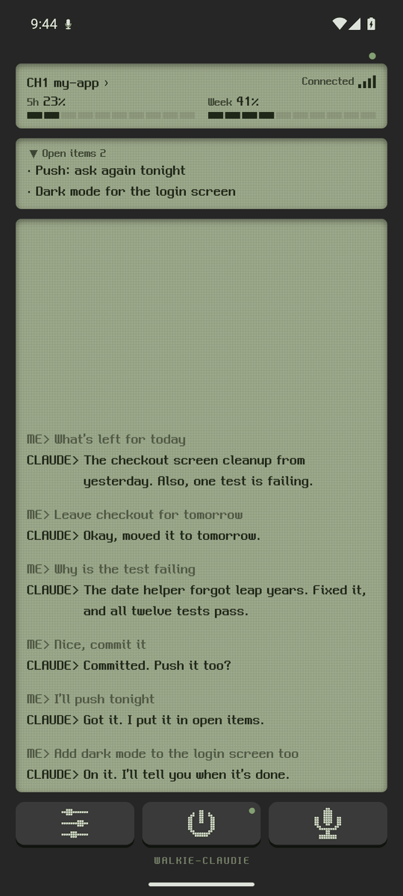
  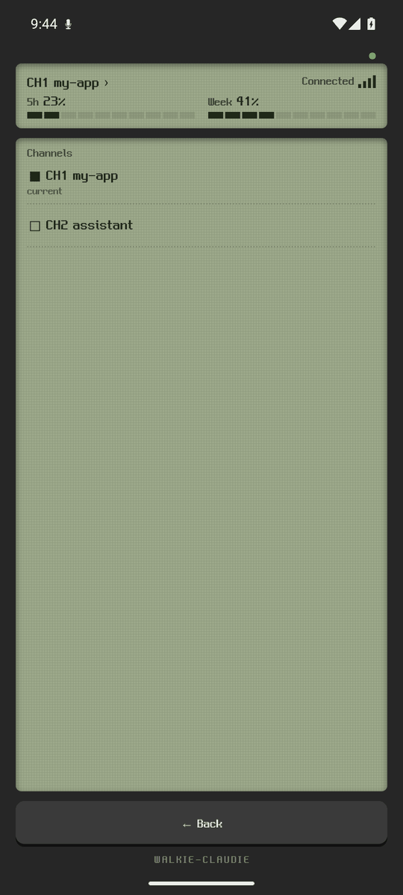
  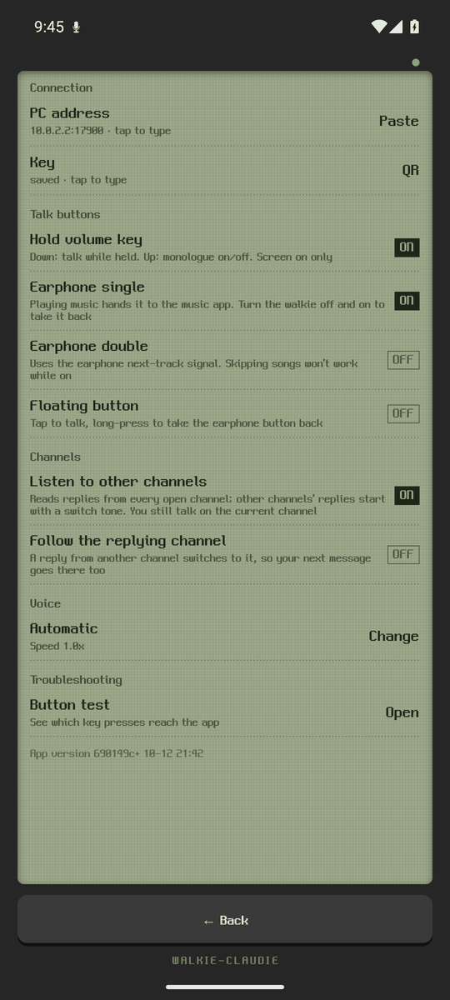
  
</p>

- Main screen: top channel, connection, usage / middle open items / bottom conversation / keys Settings, On/Off, Talk
  - On/Off key light: green on / dark off. While off, the conversation dims and "Off" appears
- Channel list: tap the top LCD (`CH1 name ›`)
- Settings: PC address and key, talk buttons on/off, channels, voice, button test
- Floating button: a small walkie over other apps. Hidden while the app is on screen
  - Light: green connected / red transmitting / blinking red disconnected

### Usage

#### Basic flow
1. Turn on: tap On on the main screen → one buzz + rising power tone
2. Talk: with whichever of the three buttons you like (each switchable in Settings)
   - Floating button: tap the mic → chirp → talk. Short pauses don't cut you off (2 minutes max)
   - Hold volume down: talk while holding. Short presses still change the volume. Screen on only; turn on Walkie-Claudie under Accessibility
   - Bluetooth earphone button: press once (or twice) to start. Works with the screen off
3. Send: tap the floating or earphone button again, or release volume down → a beep once the PC has it
4. Hear the reply: call-alert beep → the reply is read aloud
5. Turn off: tap Off → two buzzes + falling power tone

#### Extras
- Monologue mode (talking at length): hold volume up → three rising tones → let go and talk → hold volume up again to send. Long pauses are fine (10 minutes max). Starts only with the screen on (it then keeps the screen on)
- Channels (several sessions): each `WALKIE_ENABLE=1` session takes a free port (7700, 7701, …) as CH1, CH2, …
  - Tap the top LCD for the channel list → pick one to switch; its name is read out
  - The name is the session folder; change it with `WALKIE_NAME=assistant`
- Scan (on by default): listens to every open channel. Replies from other channels play after a double-beep and go into that channel's history; you still talk on the current channel
  - Turn it off under Settings › Channels; turn on "Follow the replying channel" to switch to it
- Change the voice: pick the engine, voice and speed in the Voice screen
- During calls (VoIP included): earphone button = answer/hang up, volume keys = call volume. Replies that arrive meanwhile are read after the call
- When disconnected: what you said keeps being resent until the connection is back

### More

#### Security
- What you say through the app can make the Claude on your PC run commands → keep the key safe
- Key: generated on first run (`~/.claude/channels/walkie/key`); requests with a wrong key are refused
- Only connections from private addresses (192.168.x, 10.x, 172.16–31.x, Tailscale 100.64–127.x) are accepted
- Traffic is not encrypted → on shared networks such as café Wi-Fi it can be read. Tailscale encrypts it
- If the key leaks: delete the key file → restart the session → pair again

#### Troubleshooting
- App stays "Disconnected": check the phone can reach the PC (same Wi-Fi or Tailscale), the PC firewall allows ports 7700–7709, and the session was started with `WALKIE_ENABLE=1`
- "HTTP 401": wrong key → pair again with `/walkie:pair`
- Earphone button does nothing: a music or podcast app has it → long-press the floating button
- App install blocked: Play Protect → see Setup step 3
- Accessibility switch greyed out: App info › ⋮ › Allow restricted settings first
- Usage doesn't show: the usage check is unofficial and may break after a Claude Code update → add `"statusLine": {"type": "command", "command": "bun <plugin path>/statusline.ts"}` to `settings.json`
- Which key does a button send: Settings › Button test

## License
MIT
